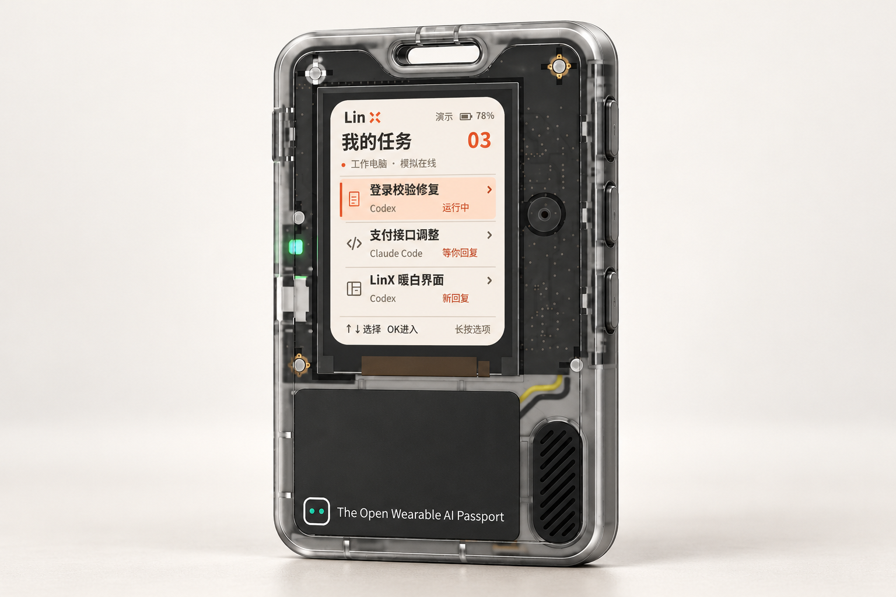
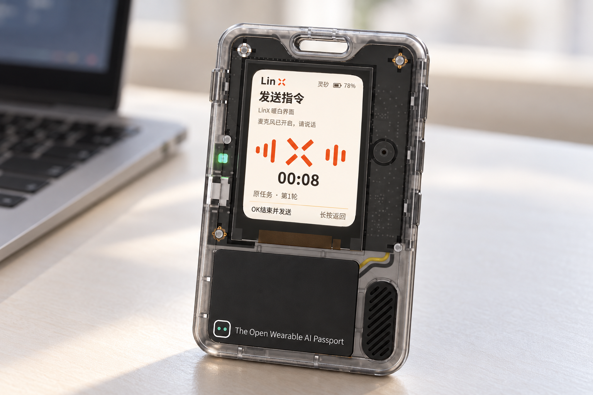

# LinxBox

[](desktop/README.md#测试覆盖率)
[](gateway/README.md#测试覆盖率)
[](firmware/README.md#测试覆盖率)

**把 AI 编程会话带到手边。**

LinxBox 是围绕 **FoloToy AI Passport** 构建的随身 AI 编程交互项目：希望让你暂时离开键盘后，也能在小屏上查看任务、阅读 Agent 的回复，并用一句话继续沟通。设备负责交互，代码仍由 Mac 上已授权的 Code Agent 执行。



任务列表

[产品体验](#产品体验) · [硬件与操作](#硬件与操作) · [参与开发](#参与开发)

## 产品体验

当 Agent 正在修改代码、运行测试，或者需要你补充要求时，我们希望把“查看进展、读回复、说下一步”这几个动作放到一块随手可用的小屏上，让你减少回到电脑前查看会话的次数。

| 使用场景 | 希望带来的体验 |
| --- | --- |
| 等待任务执行 | 浏览任务列表，了解正在运行、等待回复或有新回复的会话 |
| 查看本轮结果 | 分页阅读 Agent 的文字回复，翻看最近对话，接上之前的思路 |
| 想到下一步要求 | 选择当前任务，用语音补充“继续优化这个页面”等指令，延续原会话 |

完整体验的目标是：

1. **选任务**：在设备上找到电脑端正在进行的会话，进入概览。
2. **读回复**：打开“阅读本轮回复”或“最近对话”，用上下键翻页。
3. **说下一步**：回到概览，选择“继续沟通”；麦克风开启后说话，按一次 OK 结束并发送。
4. **等新结果**：由电脑上的 Agent 继续执行，再回到设备查看新回复。

## 硬件与操作



语音录入

当前使用 **FoloToy AI Passport** 硬件，运行本项目的 **LinX 0.2** 界面。透明外壳、顶部挂绳孔和侧边实体键沿用原设备设计。

| 项目 | 当前配置与交互 |
| --- | --- |
| 硬件平台 | ESP32-C3，8 MB Flash，无 PSRAM |
| 显示 | 240 × 320 竖屏；任务列表、文字阅读和语音状态 |
| 操作 | UP / DOWN / OK 三个实体功能键；上下键选择或翻页，短按 OK 进入或确认 |
| 返回 | 默认长按 OK；可在设备设置中改为双击，并保存偏好 |
| 语音 | 选择“继续沟通”才开启麦克风；按 OK 停录并发送，反馈播完后返回概览 |
| 配网 | 用手机连接设备临时热点，在网页中选择 2.4 GHz Wi-Fi 并保存 |

首版阅读页仅展示文字，阅读时不会开启录音；图片浏览和设备间对讲尚未提供。详细操作见[固件使用说明](firmware/README.md#灵矽配置与操作)。

## 当前分工

| 范围                  | 负责人                                          |
| --------------------- | ----------------------------------------------- |
| 项目 Leader、设备固件 | [KevinHuo](https://github.com/KevinHuo)         |
| MCP Gateway           | [BoleLiu](https://github.com/BoleLiu)           |
| macOS 客户端          | [yydounai1234](https://github.com/yydounai1234) |

跨模块改动由开发 Issue 指定 DRI、受影响模块和必要 reviewer。未在表中列出的契约、质量或集成职责不自动归属于任何人。

## 模块边界

| 模块         | 高层职责                                            |
| ------------ | --------------------------------------------------- |
| 设备固件     | 设备交互、配网、语音入口和 Gateway 客户端；源码在 `firmware/` 维护 |
| MCP Gateway  | WSS/MCP 接入、认证、设备绑定、会话目录、查询和请求状态；源码在 `gateway/` 维护 |
| macOS 客户端 | Electron UI、项目/会话同步、任务调度和本机 Codex 接入；源码在 `desktop/` 维护 |
| 共享契约     | 三端消息 Schema、fixture 和离线校验；源码在 `contracts/` 维护 |

上表只描述协作边界，不冻结接口字段或实现方案。每个模块的实现、契约和验收证据分别提交，不能用文档描述代替可运行实现或真实联调。

## 代码目录与固件

| 入口 | 内容 |
| --- | --- |
| [`desktop/`](desktop/README.md) | macOS Electron Desktop、Gateway WSS client、Codex app-server adapter、任务与结果视图 |
| [`gateway/`](gateway/README.md) | Go Gateway、WSS/MCP 入口、认证、绑定、目录、查询、SQLite 和部署文件 |
| [`firmware/`](firmware/README.md) | LinX 固件应用、硬件接入配置、配网、语音入口、资源和主机测试 |
| [`contracts/`](contracts/README.md) | 固件/Gateway/Desktop/MCP 共享 JSON Schema、fixture 和校验器 |
| [`docs/`](docs/architecture.md) | 架构设计、运行说明及联调资料 |

固件与云端、电脑端在同一 Git 仓库管理。固件使用 **[FoloToy/ai-passport](https://github.com/FoloToy/ai-passport)** 作为固定上游依赖，锁定提交 [`006c2279852e352a8433b2c21e5e09be2ca36f77`](https://github.com/FoloToy/ai-passport/commit/006c2279852e352a8433b2c21e5e09be2ca36f77)，采用 MIT 许可证；驱动、原有测试和构建校验工具从主仓库 `.local/dependencies/ai-passport/<提交号>/` 缓存读取，不重复复制维护。

当前硬件为 **FoloToy AI Passport**，ESP32-C3、8 MB Flash、无 PSRAM，使用 ESP-IDF 5.5.3。`firmware/hardware/folotoy/ai-passport/` 维护品牌型号接入配置；`firmware/main/` 维护 LinX 界面、导航、阅读、手机配网、联网与语音运行。语音协议部分参考固定版本的小智源码，保留来源及许可；关闭真实语音开关可恢复离线演示，尚未实现设备间对讲。来源与边界见[固件说明](firmware/README.md#上游来源与本地定制)。

本仓库维护的说明与工程规范统一使用中文；代码标识、命令、必要技术名称和许可证原文保持原样。上游资料通过固定版本的中文文档链接查阅，不在本仓库保存副本。

激活 ESP-IDF 5.5.3 环境后，从 `firmware/` 运行：

```sh
cd firmware
./tools/validate.sh --static
./tools/validate.sh             # 完整门禁，包含固件构建
```

验证入口和普通 `idf.py build` 会自动准备固定上游。首次获取通常需要网络，完整且校验通过的上游缓存可离线复用，也可从已有本机 Git 仓库初始化。工具链或其他管理组件尚未下载时仍可能需要联网。

单独构建使用 `./tools/validate.sh --firmware`；真实 LVGL 主机验证使用 `./tools/validate_linx_host.sh`。SDK、上游缓存、下载组件、构建和发布包均不入 Git，配置、获取方式及产物位置见[固件构建指引](firmware/README.md#构建与验证)。构建命令不烧录设备。

## 参与开发

- [AGENTS.md](AGENTS.md)：Claude Code、Codex 等 AI 助手的工作要求。
- [CODING_STANDARDS.md](CODING_STANDARDS.md)：代码组织、输入与错误处理、测试及覆盖率要求。
- [CONTRIBUTING.md](CONTRIBUTING.md)：Issue、分支、Commit、PR 和审查流程。
- [Issue 模板](.github/ISSUE_TEMPLATE/)及 [PR 模板](.github/pull_request_template.md)：协作入口。

功能范围、技术方案和跨模块契约以对应 Issue 与独立 PR 的评审结果为准。

## 架构与运行

- [架构设计](docs/architecture.md)：模块职责、数据流、安全边界和当前限制。
- [运行说明](docs/runbook.md)：使用已部署 Gateway 启动 Desktop、本地部署 Gateway、固件验证和排障步骤。

## 代码

| 路径       | 内容                                                                                        | 状态                                                                                                                                    |
| ---------- | ------------------------------------------------------------------------------------------- | --------------------------------------------------------------------------------------------------------------------------------------- |
| `desktop/` | macOS 桌面客户端：Electron UI、Gateway WSS client、Codex app-server adapter、任务与结果视图 | 已接入线上 Gateway；本地连接、任务调度和 Codex 执行可验证。安装、检查、测试、覆盖率与打包命令见 [desktop/README.md](desktop/README.md) |
| `gateway/` | Go Gateway：设备/Desktop WSS、灵矽 MCP、认证、绑定、会话目录、查询和 SQLite | 已提供 Gateway 服务实现与部署配置；线上环境的凭据、TLS、网络和端到端链路需单独验收，见 [gateway/README.md](gateway/README.md) |
| `firmware/` | ESP32-C3 LinX 固件：设备 UI、配网、语音入口、Gateway 客户端和主机测试 | 已提供构建、静态检查和主机验证入口；真机烧录及设备网络需按 [firmware/README.md](firmware/README.md) 验证 |
| `contracts/` | 三端共享消息 Schema、fixture 和 Python 校验器 | 契约唯一正文；运行校验命令见 [contracts/README.md](contracts/README.md) |
| `docs/` | 架构设计、运行说明和集成资料 | 说明当前实现边界和验证路径，不替代代码、契约或线上验收 |

## 共享协议契约

固件、Gateway、Desktop 与 MCP 的字段定义及离线校验命令见 [contracts/README.md](contracts/README.md)。Gateway 已提供 WSS/MCP 接入、绑定、会话目录、历史/正文查询、[MCP 文字提案](gateway/docs/mcp.md)及[确认投递与执行状态恢复](gateway/docs/execution.md)；Desktop 已接入线上 Gateway 并调用本机 Codex。真实设备、灵矽逐轮透传、线上凭据和完整语音闭环仍需在目标环境单独验收。
