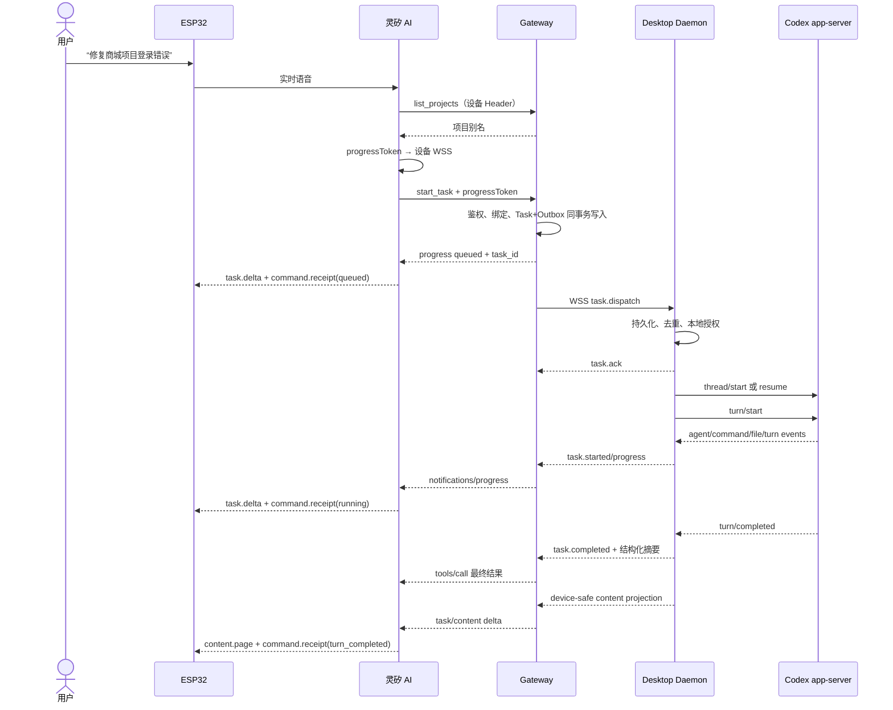

# 端到端架构串联

> Status: accepted  
> Version: 1.1  
> Last updated: 2026-10-24

本文把模块文档和四组边界契约串成一条可实现、可恢复、可验收的链路。总体部署边界仍以[总架构](architecture.md)为准。

## 1. 四条相互隔离的链路

```text
语音链路: 用户 <-> Device <-> 灵矽 ASR/TTS
控制链路: 灵矽 Agent -> MCP Gateway -> Desktop -> Codex
展示链路: Desktop device-safe projection -> Gateway -> Linx Bridge -> Device
本地审阅: Codex -> Desktop local-detail -> Desktop UI
```

控制链路不能直接发送 app-server 原始事件到 Device；展示链路不能绕过 Gateway 创建任务；语音/屏幕确认不能扩大 Desktop grant。

可选 Hooks observer 可以把其他 Codex 客户端的 Session、Stop、Interrupt 和 Permission 等事件加入只读通知，但不能进入控制链路。LinxBox 管理任务的 start/resume/interrupt 和终态仍由 app-server 提供，详见 [ADR-0005](adr/0005-hooks-observation-app-server-control.md)。

## 2. 创建任务并显示结果

1. Device 采集语音，灵矽 Agent 澄清项目并调用 MCP。
2. Gateway 验证入口、binding、project 和幂等键，事务写入 Task + Outbox。
3. Desktop 持久化 Delivery 后 ACK，再检查本地 grant 并创建 Codex turn。
4. app-server 事件经 adapter 变成稳定领域事件；Desktop/Gateway 分别持久化自己的事实。
5. progress 只下发阶段和短摘要；ACK、Agent 接受、turn 完成和 Task 成功分别显示。
6. Desktop 生成 `local-detail`、`cloud-summary`、`device-content`。只有最后一级进入展示链路。
7. Device 根据 revision/sequence 更新任务卡，分页显示回复和图片；不因新消息抢走当前页面。



## 3. 从硬件确认下一轮

1. 进入输入时 Device 冻结 task/turn/image target，创建本地 draft。
2. ASR 转写只更新 draft；超时进入确认页，不自动发送。
3. 用户确认后发送带 `command_id` 和目标快照的请求。
4. Gateway/Desktop 重新授权并去重；列表变化不改变目标。
5. Device 依次显示发送、电脑收到、排队、Agent 接受、运行和本轮结束回执。
6. 失败保留 draft；手动重试沿用 command identity，不生成重复 turn。

## 4. 事实源

| 事实 | 权威 |
| --- | --- |
| 身份、binding、云端 Task/Delivery | Gateway |
| 本地路径、grant、provider thread/turn、完整结果 | Desktop |
| provider 生命周期 | app-server，经 adapter 映射 |
| 设备页面、游标、未确认草稿和有界缓存 | Device |
| 自然语言指代 | 灵矽会话，仅作提示 |

完整消息字段见[契约索引](contracts/README.md)，模块实现顺序见[模块规范](modules.md)；各模块负责人见对应开发 Issue。
