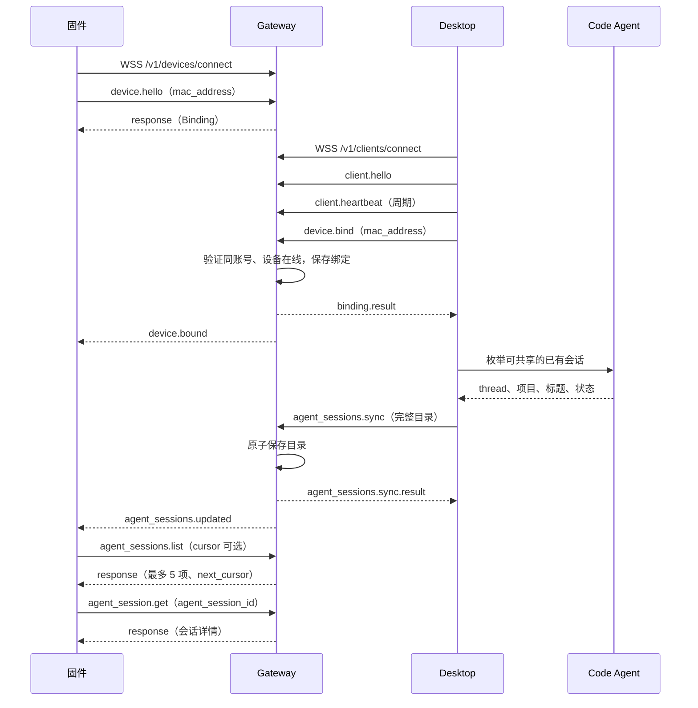
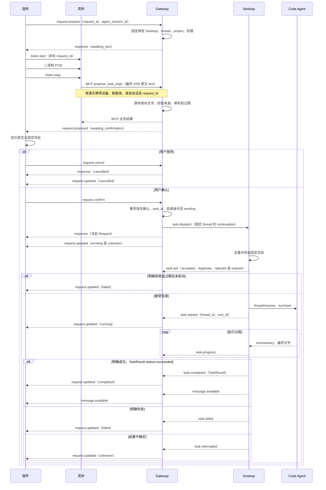
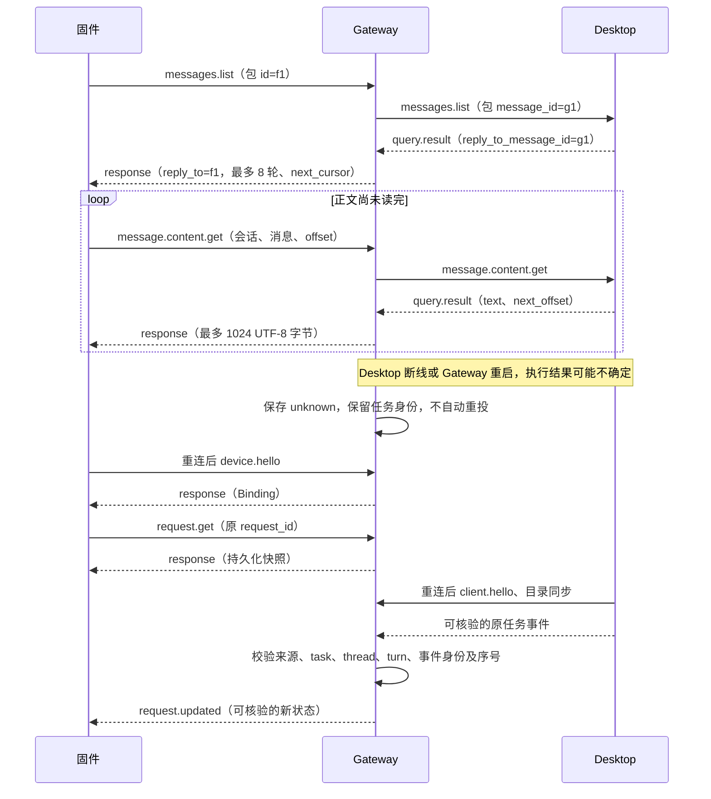
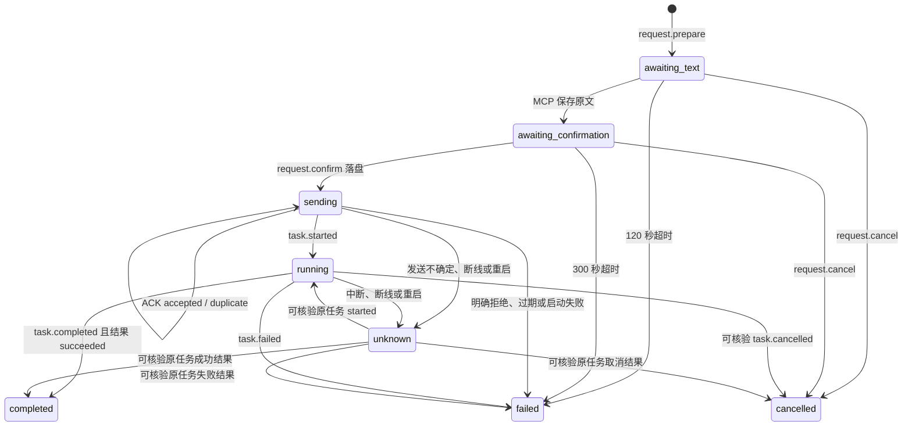

# MVP 全部接口流程与确认执行

Refs #14、#1。本任务沿用 #14 的共享契约及状态，不新增线上字段、状态查询接口、审批或执行中断入口。Gateway 责任边界沿用项目分工；受影响模块为 Gateway 与 Desktop，跨端评审需覆盖固件和 Desktop。

## MVP 目标流程

以下图为最终目标。固件 Gateway 接线、灵矽最终 ASR 固定路由和逐轮 request_id 透传仍需分别实现与真实验收，不能用 Gateway 模拟测试代替。

### 建连、绑定、目录



同一 Desktop 等目录保存应答后再发下一份；两端通知的到达顺序不是协议保证。设备 10 秒内 hello；WebSocket ping/pong 与应用 heartbeat 分开。固件的灵矽设备接入服务及其六位激活码，不等于 LinxBox Gateway 或 Desktop MAC 绑定。

### 准备、语音原文、确认、执行



图中 ACK 与 started 的展示顺序不是实现约束：Desktop 可能先发送 started，启动失败时也可能先发送 failed 再返回 rejected ACK。Gateway 都须处理，ACK 不推进 running。MCP 与 TTS 也不保证相对到达顺序，语音播完不能证明任务成功。

### 历史、正文和恢复



不存在 `task.status.get`，也不通过重新执行查询结果。未收到可核验事实时保持 unknown。历史最新到最旧并保留轮次；offset 为 UTF-8 字节偏移，正文块不是屏幕页码。

### Request 状态



completed、failed、cancelled 不回退。unknown 若来自真实 interrupted 终态，保留该任务的终态屏障；若来自连接中断，则可由原任务后续事实收敛。缺少一致 TaskResult 的 completed 保存为 unknown，不伪造成功或锁成已核实终态；允许原任务补报更高序号、全新 event_id 的有效终态事实。此时迟到的 started/progress 不能把请求回退到 running。

### 全部共享消息索引

共 37 项，按链路和方向计数；同名跨两条链路的消息分别计数。定义见根目录 contracts/，本表不建立第二份字段契约。

| 方向 | 消息 |
| --- | --- |
| 固件 → Gateway（9） | `device.hello`、`agent_sessions.list`、`agent_session.get`、`messages.list`、`message.content.get`、`request.prepare`、`request.confirm`、`request.cancel`、`request.get` |
| Gateway → 固件（6） | `response`、`device.bound`、`agent_sessions.updated`、`request.proposed`、`request.updated`、`message.available` |
| Desktop → Gateway（14） | `client.hello`、`client.heartbeat`、`device.bind`、`agent_sessions.sync`、`query.result`、`message.available`、`task.ack`、`task.started`、`task.progress`、`task.completed`、`task.failed`、`task.interrupted`、`task.cancelled`、`task.approval_required` |
| Gateway → Desktop（8） | `binding.result`、`agent_sessions.sync.result`、`messages.list`、`message.content.get`、`task.dispatch`、`project.upsert`、`project.revoke`、`task.cancel` |

`project.upsert/revoke` 保留项目元数据兼容，不授予本机路径权限。首版不开放 `task.cancel` 执行中断或 Agent 审批入口；识别 `task.approval_required` 时提示电脑端处理，不自动批准，识别可核验 `task.cancelled` 时记录真实终态。

语音通道另有双向 hello、listen.start/stop、上行 PCM、stt、tts.start/stop、下行 Opus/PCM、abort。语音 abort、确认前 request.cancel、执行中 task.cancel 分属不同层次。MCP 工具只有 propose_task_reply，工具参数只有 text，其他上下文来自认证来源头。

## 本次实现与限制

- Gateway 在发送前事务保存确认及 request/task/dispatch 映射；重复确认只返回原快照。Desktop 离线且尚未确认时返回依赖不可用，保留待确认；落盘后发送失败保存 unknown，不自动重发。
- ACK 配对原 dispatch 的 message_id、sequence、task_id；started 才进入 running。执行事件核对当前认证 Desktop、固定 thread/turn、event_id 指纹和任务内序号；重复无副作用，串线、乱序、冲突及终态回退被拒绝。
- 追加迁移 004，保留旧迁移；Gateway 启动恢复 sending/running 为 unknown。目录移除不删除在途映射；新确认仍校验原目标存在且未改路由，旧账号不能查询或接收原请求通知。
- Desktop 仅在 provider 明确完成且无错误时生成本轮追问的 TaskResult。changes/verification 暂为空数组，risk 明确说明未汇总执行详情；不声称没有改动、测试已通过或整个工程已验收。
- Desktop 完整执行事实投影、持久去重与跨进程结果补报仍需后续工作；Gateway 本次不会因重复确认、断线或重启重新投递任务。没有自动重投或事件重放机制。
- 固件业务接线、灵矽固定路由／逐轮 ID、Desktop 目录同步应答等待和按轮次历史分页不在本次确认执行改动中。完整 MVP 必须分别补齐并提供真实链路证据。

## 检查入口

从 gateway/ 执行 `make check`、`make build`、`make smoke-local`；定向用例为 `go test -race ./internal/service ./internal/transport -run 'TestConfirm|TestExecution' -count=1`。这些测试使用模拟 Desktop／执行事件，不连接真实模型、固件或灵矽。

从 desktop/ 执行 `pnpm typecheck`、`pnpm test`、`pnpm coverage`，本次结果回归位于 daemon/gateway-client/confirmation-result.test.ts。实际结果另行记录，命令清单不表示已经通过。

## 本次验证记录（2026-10-25）

基线为 df045c82c1f8a1e7ebc1e0513ebe7c97ee41a270，在隔离工作区验证，避免与其他任务的 MCP 日志改动混合。

- Gateway：`make check build` 通过，包含格式、go vet、全部单元／集成测试、覆盖率门禁和 race。整体语句覆盖率 92.64%（2455/2650）；service 91.36%、storage 92.22%、transport 92.82%，所有关键包保持原有 90% 门槛。
- 回归覆盖并发重复确认、事务失败不发送、固定目标、ACK 晚到与冲突、事件去重／乱序／串线、成功／失败／中断、连接代次、真实关闭并重开 SQLite 后恢复，以及 WebSocket 确认→dispatch→执行事件→固件快照。
- Desktop：改动文件格式与 lint、类型检查、构建通过；新增 2 项结果对接测试通过。
- Desktop 全量测试未通过：当前 588 通过、12 失败、3 跳过；独立导出的原提交在相同依赖与回环网络条件下为 586 通过、相同的 12 项失败、3 跳过。失败名称集合完全一致，未删除断言或修改既有测试来放行。既有问题涉及授权／续接／取消、目录标识、provider 错误及 mock 控制台；因此不能声明 Desktop 全量检查或覆盖率门禁通过。
- 未连接真实灵矽、设备或模型执行任务，未烧录、部署或进行真实三端语音验收。

## MCP 日志合入与服务器包（2026-10-25）

当前工作区已合入日志提交 41e89f8aa372f0e2b7af7489ad5d8ceadf0e7b0b 的实现与回归测试，保留本次确认投递、执行事件和 unknown 恢复。合并后重新执行 `make check build release`，格式、go vet、全部单元／集成测试、race 与原覆盖率门禁通过；整体覆盖率 92.89%（2613/2813），service 91.36%、storage 92.22%、transport 93.48%。

Linux amd64／arm64 的 Gateway 和 smoke 工具均使用 CGO_ENABLED=0 静态交叉编译；部署包包含 systemd、安装脚本、配置示例、日志查看说明、源码指纹及 SHA-256 校验和。默认 info 文本日志可查看 MCP 调用阶段、通知入队／离线／失败及任务事件。包内不包含私人配置、真实凭据或数据库。

新装默认配置 WS 凭据，接入 MCP 仍须配置独立 MCP 凭据与真实设备／智能体标识；已有部署保留原配置，若其日志级别为 warn/error，应调整为 info 才能看到正常流程日志。尚未在目标 Linux 主机执行安装、部署或真实语音联调。包身份包含未提交源码指纹，不能只用基线提交号代替二进制 SHA-256。

## 三项实现整合与安装包纠正（2026-10-26）

此前 b7f5851 安装包包含 Streamable HTTP 和缺头联调关联，却未包含 request-execution 工作树中尚未提交的确认执行实现，因此真实日志在 request.confirm 直接返回“任务调度尚未实现”。这是整合打包遗漏，不代表本文件描述的确认执行代码从未实现。

当前 codex/gateway-mvp-integration 分支从来源工作树冻结导入执行类型、服务、迁移 004、传输接线和 Desktop 结果投影；来源工作树未修改。保留 Streamable HTTP、旧 SSE、MCP 日志和显式开启的缺头联调模式。源码版本以新安装包 VERSION/SOURCE_COMMIT 为准，不再仅用来源工作树基线版本识别安装包。

新增 TestMVPStreamableImplicitConfirmDispatchAndCompletion，使用临时数据库与真实本机 HTTP/WS，验证无请求 ID 的 MCP 原文提案 → 固件确认 → Desktop 收到固定 thread/project 的 task.dispatch → ACK/started/TaskResult completed → 固件读取 completed，并断言重复确认只投递一次。该测试将三项能力放在同一链路，避免各自测试通过却分开发包。

- Gateway：make check build release 通过，含格式、静态检查、所有测试、覆盖率与 race；整体 93.10%（2793/3000），service 91.24%、storage 91.62%、transport 94.15%，保持原门槛。增量覆盖率基于同一 coverage.out 单独运行 covergate。
- Desktop：使用 package.json 对应的本地 tsc/Vitest/build 入口（pnpm 自动依赖重装触发无 TTY 阻塞），改动文件格式/lint、类型检查、构建和新增 2 项投影测试通过。完整测试 588 通过、12 失败、3 跳过；独立导出 b7f5851 基线为 586 通过、相同 12 失败、3 跳过。完整覆盖率执行失败：分支 82.97%，低于 90%；语句 91.75%、函数 91.95%、行 92.75%。未删除旧断言、降低门槛或修改无关失败。
- 未更新固件或部署腾讯云；真实 Desktop/Code Agent 的执行与三端语音闭环仍需重新验收。已使用旧 Desktop 时，须核对其是否包含本文件所述结构化 TaskResult 投影；缺少结果事实时 Gateway 保持 unknown，不伪造 completed。

升级新增迁移 004，需停服备份完整 SQLite 数据目录后安装。启动会将既有 sending/running 收敛到 unknown，不自动重投。回退程序时同时恢复升级前配置和数据库备份。

## Gateway 结果恢复与占用排查（2026-10-26）

本次仅修复现有共享契约下的 Gateway 执行事实恢复和内部日志，不新增接口、状态、错误字段、自动重投、执行取消或人工批准入口。DRI：BoleLiu；主模块：Gateway；必要跨端评审：KevinHuo（固件）、yydounai1234（Desktop）。

`task.completed` 的 `result=null` 或 result.status 不是 succeeded 时，Gateway 保持 unknown 和设备/会话占用，但不再设置终态屏障。已部署旧版本写入的 `unknown + DEPENDENCY_UNAVAILABLE + 完成事件缺少一致的成功结果，不能确认任务成功` 也适用恢复，无需删除数据库、修改旧迁移或手动改 terminal 字段。

恢复仍须由当前认证且归属一致的 Desktop，通过既有任务事件补报原 task_id/thread_id/turn_id 的可核验终态。补报使用新的 event_id 和大于已保存 last_event_sequence 的序号；不能修改旧 event_id 的内容。原样重复事件保持幂等；不同账号、任务、会话或 turn、过期序号以及事件身份冲突仍被拒绝。已核实 completed/failed/cancelled 及真实 interrupted 的屏障不受影响。完成结果待核实期间只接受后续终态事实，started/progress 不使它回退到运行中。

收到有效成功结果后保存 completed，收到一致失败/取消事实后保存对应状态，并释放 Request 的设备和会话占用。目录状态仍单独检查：Desktop 目录若为 running/unknown，仍不能创建新追问。没有补报时继续保持 unknown；重启、重复确认、语音 abort 或确认前 request.cancel 都不能解除已确认任务占用。更新 Gateway 本身不生成执行证据，也不为旧版 Desktop 增加结果补报能力。

`request.prepare` 冲突时，日志新增 blocking_request_id、blocking_status、blocking_scope、blocking_request_count 和 target_status。scope 为 device、session 或 device_and_session；有两个不同占用者时，第二条使用 `_2` 后缀。只有目录状态冲突时 count=0，通过 target_status 定位。诊断留在服务端日志，不扩展固件响应。prepare 失败不会创建新 request_id，应按日志中的旧 request_id 查询，查询失败的新 ID 返回 NOT_FOUND 属于预期。

request.state 的 response_body 改为实际 FirmwareResponseBody（ok/data/error）；失败时展示实际错误，而非全为空的 Request。通知日志对 Gateway 产生的固定状态错误保留安全原文，并标明 state_error_source=gateway；未知对端异常、文字、路径和凭据继续脱敏。

服务器可先根据日志中的旧请求定位持久身份。使用配置 database.path；默认路径的只读检查示例（需 sqlite3）如下，不读取识别正文、标题或结果内容：

```sh
sudo sqlite3 -readonly /var/lib/linxbox/gateway.db <<'SQL'
SELECT r.request_id, r.agent_session_id, r.status, r.error_code,
       e.task_id, e.turn_id, e.last_event_sequence, e.terminal
FROM requests r
LEFT JOIN request_executions e ON e.request_id = r.request_id
WHERE r.device_id = '4C:11:AE:32:D2:38'
  AND r.status IN ('awaiting_text','awaiting_confirmation','sending','running','unknown');
SQL
```

随后由 Desktop 核对原任务结果并补报；用固件 request.get 查询旧请求快照，确认收敛后再建立新请求。本次未访问或更改服务器数据库，也未部署修复。

回归先在旧实现复现误设终态、旧库补报被拒和错误原因被脱敏，再验证修复。用例包含空结果与不一致结果、旧 terminal 记录关闭/重开 SQLite 后恢复、补报去重和串线/乱序拒绝、真实终态不可覆盖、设备/会话/双重/目录占用定位，以及真实 WebSocket 编解码下的 unknown→冲突→补报 completed→新请求成功（模拟 Desktop）。

## PR #26 开发线整合（2026-10-26）

将 PR 分支中的 5b30e12、37b3917 与 Streamable HTTP、缺省请求 ID 联调及记录缺失诊断合并，保留两边提交历史。此前 3827d95 部署包只手动导入了 5b30e12 的确认执行实现，未包含 37b3917 的结果恢复修复；提交 PR 不会自动替换该安装包或服务器程序。

TestMVPStreamableImplicitConfirmDispatchAndCompletion 同时覆盖直接成功与缺结果补报：缺头 MCP 提案 → 固件确认 → 固定 Desktop 投递 → started → 缺结果 completed 保存 unknown → 新 prepare 冲突且失败 ID 查询为 NOT_FOUND → 原任务以新事件和更高序号补报成功结果 → completed → 新 prepare 成功。重复确认始终只投递一次。请求选择仍检查设备、Desktop 绑定和账号归属，未放宽认证。

整合后执行 `INCREMENTAL_BASE=origin/main make check build release` 通过，含生成核对、格式、go vet、全部单元/集成测试、整体/关键包/增量包原有覆盖率门禁及 race。本机及 Linux amd64/arm64 无 CGO 构建通过。整体语句覆盖率 93.08%（2826/3036），service 91.19%、storage 90.95%、transport 94.25%；均未降低门槛。定向执行恢复、MCP 组合链路及记录缺失诊断的 race 回归通过。Desktop 运行代码与 37b3917 一致，本轮未重跑其全量检查；此前失败记录继续保留。未部署服务器或执行真实平台/固件/模型验收。
